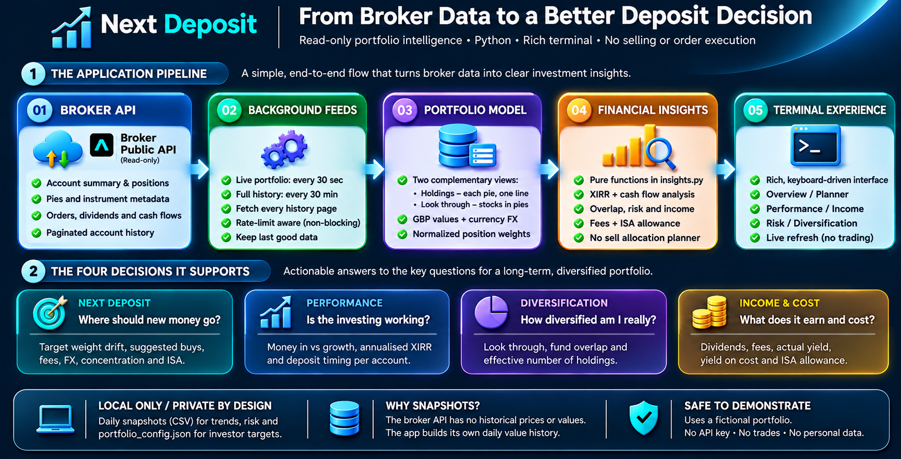

# Next Deposit: Project Documentation

**A no-sell deposit planner and portfolio monitor for a monthly investor | Stocks ISA | Python**

This document explains why I built Next Deposit, the four questions it answers, how each answer is worked out, what it found on my own account, how the system is built, how I checked it, and where it falls short. Formulas for every figure are in [METRICS.md](docs/METRICS.md). Day-to-day use is in the [User Guide](docs/USER_GUIDE.md).

**Status (1 November 2026):**
- **Live use:** running daily against my Stocks ISA, using the full account history (115 transactions, 158 orders, 28 dividends).
- **Demo mode:** reproduces every page without an account.
- **Not built yet:** a benchmark comparison, which needs an outside price source, and an automated test suite.

## Contents

1. [The problem](#1-the-problem)
2. [Question 1: Where should my next deposit go?](#2-question-1-where-should-my-next-deposit-go)
3. [Question 2: Is my investing actually working?](#3-question-2-is-my-investing-actually-working)
4. [Question 3: Am I as diversified as I think?](#4-question-3-am-i-as-diversified-as-i-think)
5. [Question 4: What is it earning, and what is it costing?](#5-question-4-what-is-it-earning-and-what-is-it-costing)
6. [How it's built](#6-how-its-built)
7. [How I checked it](#7-how-i-checked-it)
8. [Limitations and what's next](#8-limitations-and-whats-next)
9. [Glossary and references](#9-glossary-and-references)

---

## 1. The problem

I invest monthly through a Stocks ISA: index funds, some individual shares and a dividend "pie" (a basket that splits each deposit across about 50 stocks). Each month brings the same decision, **where does this money go?**, and the app doesn't help with it. It shows what each holding is worth and its gain, but:

- **There's no target.** It can't tell you what's under- or over-weight relative to the mix you want, or what a purchase would change.
- **The return ignores timing.** "+10%" looks the same whether the money went in two years ago or last month.
- **Pies are a black box.** A pie appears as one line, but the stocks inside change your currency exposure and can duplicate funds you already own.
- **Costs and income are scattered.** FX fees, stamp duty, dividends and the ISA allowance are only visible in individual transactions.

> **Research question:** *For a regular monthly investor, where should the next deposit go, and is the portfolio genuinely performing, diversified and cost-efficient?*

I wanted a tool I'd actually leave running, so three constraints shaped it:
1. **Read-only.** It never places orders.
2. **Documented figures.** Every number has a written definition, and estimates are labelled as estimates.
3. **Private.** My account data never leaves my machine.

---

## 2. Question 1: Where should my next deposit go?

**The decision.** I have £X to invest this month and a mix I'm aiming for. What should I buy, without selling anything (selling in an ISA is tax-free, but it costs spreads and FX fees, and breaks the habit)?

**How Next Deposit answers it.** I set a target weight per holding on the Planner page, directly on screen. The planner then:

1. Works out the portfolio total *after* the deposit.
2. Calculates each holding's shortfall against its target at that new total.
3. Fills the biggest shortfalls first. If the deposit is more than all the shortfalls combined, it splits the remainder by target weight.

It never suggests a sale, and holdings without a target get no new money. A pie counts as one holding, because money added to a pie is split across its stocks by the pie's own targets. A side panel shows which stocks inside the pie are furthest below target.

**Seeing the impact before buying.** Planning a purchase is only useful if you can see what it changes. Every plan, auto-split or a "what if" scenario where I type my own amounts, shows before → after for:

| | |
| --- | --- |
| Value | Portfolio value after the deposit, net of estimated fees |
| Fees | FX conversion (0.15% on non-GBP shares) and stamp duty (0.5% on UK shares). Pie purchases are spread across the pie's actual stocks |
| Currency mix | GBP / USD / EUR exposure, look-through |
| Asset type | ETF vs individual stocks |
| Concentration | Largest holding, and anything over 25% |
| ISA allowance | What's left this tax year |

**What it showed.** A test scenario of £50 into Microsoft and £25 into an S&P 500 fund raised USD exposure by about ten percentage points, and made that fund, not the pie, the largest holding. That's the kind of side effect that isn't obvious from the app.

**Design choices worth noting**
- Targets are shares of the *whole* portfolio. If some holdings have no target, every targeted holding looks under target once new money arrives. The planner says so, rather than hiding it.
- Typing a target **replaces** the old value, and is saved straight away. The cursor follows the *holding*, not the row number, because rows reorder when the pie loads. Both were real bugs found in testing.

---

## 3. Question 2: Is my investing actually working?

**Why the app's figure isn't enough.** The broker reports unrealised gain on what you currently hold. That ignores *when* each deposit was made, and it isn't annualised. £100 up 10% over two years is roughly 4.9% a year. £100 up 10% in two months is far better.

**How Next Deposit answers it.** From the complete deposit, withdrawal and transfer history, it reports:

| Measure | What it tells you |
| --- | --- |
| **Your money in (net)** | Deposits + transfers in − withdrawals − transfers out |
| **Market growth** | Total value − net money in: what the market added on top |
| **Real return (XIRR)** | The annualised, money-weighted return, accounting for the date of every deposit |
| **Net money in per month** | Last 12 months, plus the current deposit streak |
| **Fees actually paid** | FX and stamp duty charged on every fill, as a % of the amount traded |

**Getting complete data was the hard part.** The API returns history in pages of 50. Its "next page" link already contained the API's path prefix, and the original code added it a second time. **Every history request had quietly been returning only the first 50 records.** Any total built on that (money in, fees, dividends) would have been wrong without any visible error. After the fix, the full history loaded: 115 transactions and 158 orders, not 50 of each.

**What it showed.** A money-weighted return of **10.5% a year**, against a simple unrealised return of **10.0%**. Net money in reconciled to the broker's reported cost of holdings **to within £0.22**.

---

## 4. Question 3: Am I as diversified as I think?

**Why the app's view misleads.** Fifty-plus holdings sounds diversified. But size matters more than count, and funds can hold the same companies under different names.

**How Next Deposit answers it.** It analyses the portfolio **look-through**: every stock inside the pie is counted by its own value, currency and type, alongside the funds and shares held directly.

| Measure | Meaning |
| --- | --- |
| **Effective number of holdings** | 1 ÷ Σ(weight²): how many equal-sized positions the portfolio behaves like |
| **Positions under 1%** | How much of the portfolio sits in positions too small to matter individually |
| **Overlap** | Funds tracking the same index (S&P 500, FTSE All-World, MSCI World, gold), and the same fund (identical ISIN) held on two listings |
| **Risk from history** | Drawdown, best and worst day, and volatility, from the daily snapshots, **with deposits removed** so adding money isn't counted as a gain |

**What it showed.**
- **Few effective holdings:** 54 positions behaved like **11.3** equal holdings.
- **Many tiny positions:** **44** were each under 1%, together **27%** of the portfolio.
- **Overlapping funds:** three S&P 500 trackers held **24%** and two FTSE All-World funds **14%**, adding lines without adding diversification.
- **A duplicate:** one gold ETC was held on two listings with the same ISIN.

---

## 5. Question 4: What is it earning, and what is it costing?

| Area | What Next Deposit shows |
| --- | --- |
| **Dividends** | Last 12 months, by month, top payers, yield on cost (12-month dividends ÷ cost of holdings), and a simple "if payouts repeat" estimate for the next 12 months |
| **Costs** | Fees actually charged, by type, from every order fill |
| **ISA allowance** | Deposits this tax year (6 April to 5 April) against the £20,000 allowance, and days left |

**What it showed.**
- **Fees** were **0.13%** of the amount traded, most of it FX conversion on US shares. That points toward GBP-quoted funds where the same exposure is available.
- **Dividend yield on cost** is still low, because the dividend pie is under a year old. It'll become a meaningful trend as the history builds.

---

## 6. How it's built

**Source.** The broker's official public API (beta), with a **read-only** key. It provides positions, pies, instrument metadata and paginated history, but **no historical prices or portfolio values**, and it's rate-limited per account. Some endpoints allow only one request every 30 or 50 seconds.

**Decisions that made it usable day to day**

| Decision | Why |
| --- | --- |
| **Two background threads** (live every 30s; full history every 30 min) | The screen never freezes on the network. Slow history paging waits out rate limits without blocking anything |
| **Keep the last good data on failure**, and show the reason in the status bar | A rate limit or network blip shouldn't blank the screen or show stale numbers as fresh |
| **Two views of the portfolio**: holdings (each pie as one line) and look-through positions | Decisions are made at the holding level; diversification and currency exposure need the look-through |
| **Daily snapshots** (CSV, local only) | The API has no history of values, so the tool builds its own for trends and risk |
| **All calculations in `insights.py`**, as pure functions | Each figure can be checked on its own, separate from the screen |
| **Full-screen terminal UI** (Rich), keyboard-driven | Built to be left running. A web version was tried and dropped because the terminal suited monitoring better |
| **Demo mode** (`--demo`): a fictional portfolio in exact API shapes | Lets anyone try every page without an account; all screenshots come from it |

**Code layout:** `next_deposit.py` (API client, portfolio model, data feed, interface), `insights.py` (calculations), `demo_data.py` (fictional portfolio), `tools/render_screenshots.py`. More in the [Development Guide](docs/DEVELOPMENT.md).

---

## 7. How I checked it

| Check | Result |
| --- | --- |
| Holding values and quantities against the broker's own figures, including the pie | Agreed |
| Net money in against the broker's reported cost of holdings | Within £0.22 |
| Full history retrieval after the pagination fix | 115 transactions, 158 orders, 28 dividends |
| Every page rendered at 160×50 and 110×45 | Fits; the narrow layout drops the orders panel to fit |
| Keyboard use in a pseudo-terminal: switching pages, editing and saving targets, scenario mode, quitting | No errors; two bugs found and fixed (typed targets appended to old values; the cursor could jump rows when the pie loaded) |
| A second client competing for the same rate limit | Last good data kept, with the reason shown |
| Demo mode end to end, with no credentials | Passed |
| Repository contents | No credentials, snapshots or targets; screenshots from demo data only |

---

## 8. Limitations and what's next

| Limitation | Effect | Next step |
| --- | --- | --- |
| No historical prices from the API | No "vs the market" comparison; risk measures depend on the tool's own snapshots | Add an outside price source and compare against "every deposit into a global index fund" |
| Snapshots exist only for days the tool ran | Gaps are treated as a single step | Run it daily |
| Several pies are combined for look-through | Allocation inside each pie is approximate | Model each pie separately |
| Planned fees use fixed rates | Estimates only | Compare with fees actually charged (shown on Performance) |
| The ISA figure counts deposits only | Transfers from another account need a manual check | Flag transfers explicitly |
| No automated tests yet | Checks are scripted and manual | Unit tests for `insights.py`: XIRR, planner split, drawdown, overlap |

**What the project demonstrates**
- **Financial judgement:** choosing the right measure (money-weighted vs simple return, look-through vs face value, deposit-adjusted risk), and being clear about estimates.
- **Decision support:** a no-sell allocation method with an impact preview.
- **Reliable data engineering:** complete paginated history, rate-limit handling, graceful failure.
- **Product thinking:** a tool built for a real monthly routine, with demo mode and documentation, and with privacy built in.

The findings describe one account and are not investment advice.

---

## 9. Glossary and references

| Term | Meaning |
| --- | --- |
| ISA | Individual Savings Account: a UK tax-free wrapper with a £20,000 annual allowance |
| Pie | A broker-managed basket of instruments with target weights |
| Look-through | Analysing the stocks inside a pie or fund, not just the wrapper |
| XIRR | Annualised, money-weighted return for irregular deposits |
| Effective number of holdings | 1 ÷ Σ(weight²), the inverse Herfindahl index |
| Drawdown | Fall from a previous peak |
| GBX | Pence sterling, the quote currency of many London listings |
| SDRT | Stamp Duty Reserve Tax: 0.5% on purchases of most UK shares |

**References:**
- [GOV.UK: Individual Savings Accounts](https://www.gov.uk/individual-savings-accounts)
- [GOV.UK: Stamp Duty Reserve Tax](https://www.gov.uk/guidance/stamp-duty-reserve-tax-the-basics)

**In this repository:** [User Guide](docs/USER_GUIDE.md) · [Metrics](docs/METRICS.md) · [Development Guide](docs/DEVELOPMENT.md)

---

*Next Deposit is an independent, open-source personal project, published as a portfolio case study. It is not affiliated with, endorsed by or sponsored by any broker. It reads the author's own account through the broker's public API with a read-only key, never places orders, and is an analysis tool, not financial advice.*
