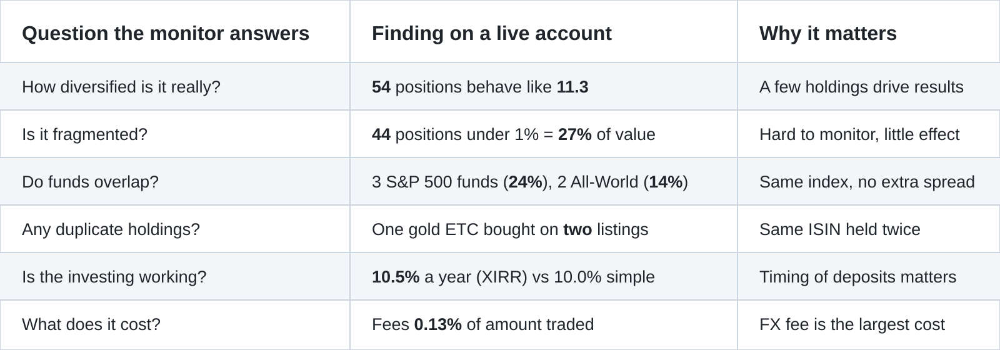
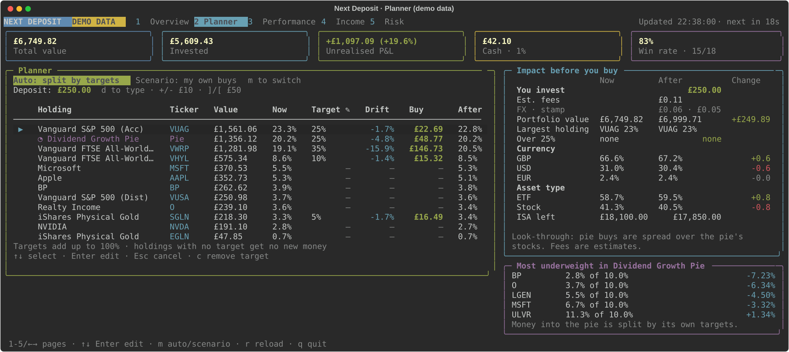
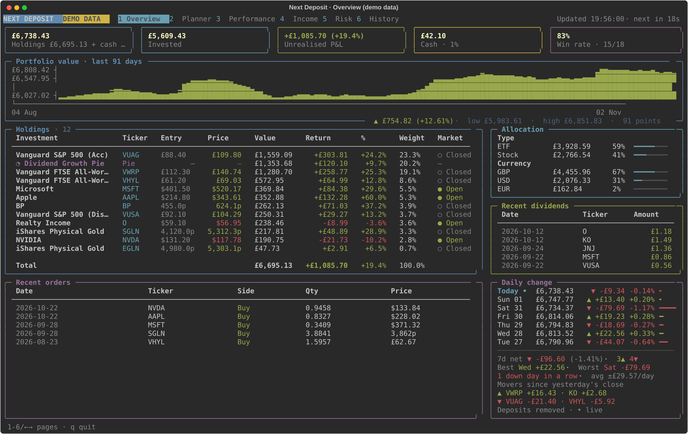
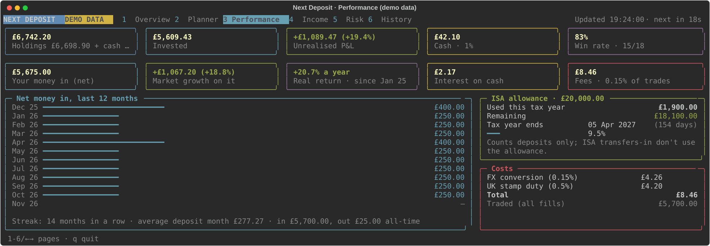
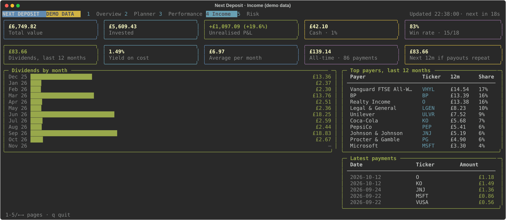
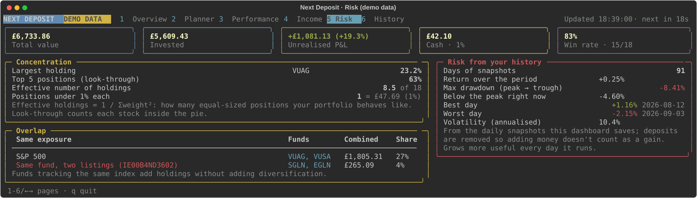
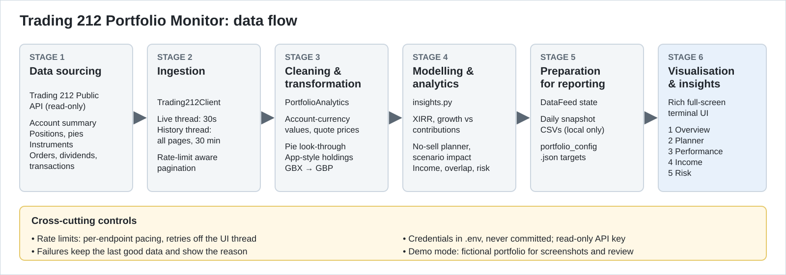

# Next Deposit

**A no-sell deposit planner and portfolio monitor for a monthly investor's Stocks ISA.**

Next Deposit helps a regular investor decide where the next deposit should go, and tracks money-weighted performance, diversification, fund overlap, income, costs, ISA allowance and deposit-adjusted risk.

I invest every month through a Stocks ISA. Each time, I faced the same decision with no help from the app: *where does this deposit go?* The app shows what each holding is worth. It doesn't show what's under- or over-weight, how my return looks once deposit timing is considered, what I'm paying in fees, or how much my funds overlap. I built Next Deposit on the broker's official public API to answer those questions. It runs as a live, full-screen terminal app.

## The question

> **For a regular monthly investor, where should the next deposit go, and is the portfolio genuinely performing, diversified and cost-efficient?**

Next Deposit breaks that into four questions:

| Question | How it's answered |
| --- | --- |
| **Where should my next deposit go?** | Set target weights on screen. The planner splits the deposit toward them **without selling**, and previews the impact before you buy: fees, currency mix, concentration, ISA allowance left |
| **Is my investing actually working?** | Money in vs market growth, and a **money-weighted annualised return (XIRR)** that accounts for when each deposit went in |
| **Am I as diversified as I think?** | **Look-through** analysis of every stock inside pies, the effective number of holdings, and funds that track the same index |
| **What is it earning and costing?** | Dividends by month and yield on cost, fees actually charged, and ISA allowance used |

[Read the full project documentation](PROJECT_DOCUMENTATION.md).

## What it found on my account

Balances are deliberately left out. These are ratios and counts only.



<details>
<summary>View the findings as a text table</summary>

<table width="100%">
  <thead><tr><th align="left" width="30%">Question</th><th align="left" width="40%">Finding</th><th align="left" width="30%">Why it matters</th></tr></thead>
  <tbody>
    <tr><td>How diversified is it really?</td><td><strong>54</strong> positions behave like <strong>11.3</strong> equal holdings</td><td>A few holdings drive results</td></tr>
    <tr><td>Is it fragmented?</td><td><strong>44</strong> positions under 1% = <strong>27%</strong> of value</td><td>Hard to monitor, little individual effect</td></tr>
    <tr><td>Do funds overlap?</td><td>3 S&amp;P 500 funds (<strong>24%</strong>), 2 FTSE All-World funds (<strong>14%</strong>)</td><td>Same index, no extra diversification</td></tr>
    <tr><td>Any duplicate holdings?</td><td>One gold ETC held on <strong>two</strong> listings</td><td>Same ISIN held twice</td></tr>
    <tr><td>Is the investing working?</td><td><strong>10.5%</strong> a year (XIRR) vs 10.0% simple return</td><td>Deposit timing matters</td></tr>
    <tr><td>What does it cost?</td><td>Fees <strong>0.13%</strong> of the amount traded</td><td>FX conversion is the largest cost</td></tr>
  </tbody>
</table>

</details>

**What it points to:** directing new money toward under-target holdings rather than adding more small positions, consolidating overlapping index funds, and favouring GBP-quoted funds where FX fees can be avoided.

**Getting the data right mattered.** The API returns history in pages of 50, and a path-prefix bug meant every history request had quietly returned only the first page. Money in, fees and dividends would all have been understated, with no visible error. After the fix, the full history loaded: 115 transactions and 158 orders. Net money in now reconciles to the broker's reported cost to within £0.22.

**Limits:**
- **Estimates:** fee figures for planned purchases are estimates (0.15% FX, 0.5% UK stamp duty).
- **No price history:** the API provides none, so trends and risk come from the tool's own daily snapshots, and there's no benchmark comparison yet.
- **One account:** these findings describe a single account and are not investment advice.

## The planner



<details>
<summary>All five pages (demo data)</summary>

| Page | Shows |
| --- | --- |
| [1 Overview](docs/images/page-1-overview.svg) | Value, P&L, value chart, holdings with entry and current price (each pie as one line), allocation, recent activity |
| [2 Planner](docs/images/page-2-planner.svg) | Targets, drift, suggested buys, "what if" scenarios, impact before you buy |
| [3 Performance](docs/images/page-3-performance.svg) | Money in vs growth, XIRR, monthly deposits and streak, ISA allowance, fees |
| [4 Income](docs/images/page-4-income.svg) | Dividends by month, yield on cost, top payers |
| [5 Risk](docs/images/page-5-risk.svg) | Concentration, overlapping funds, deposit-adjusted drawdown and volatility |






</details>

Screenshots use a **fictional demo portfolio**, never a real account.

## How it works



- **No freezing:** two background threads pull live data every 30 seconds and the full history every 30 minutes, waiting out the broker's rate limits, so the screen never waits on the network.
- **Two views of the portfolio:** an app-style **holdings** view (pie as one line) for decisions, and a **look-through** view for diversification and currency exposure.
- **Documented calculations:** all live in `insights.py`, with every formula written up in [METRICS.md](docs/METRICS.md).
- **Your data stays on your machine:** daily snapshots and your targets are never committed.

## Run the demo

```bash
git clone https://github.com/TeslimAdeyanju/next-deposit.git
cd next-deposit
python3 -m venv .venv && source .venv/bin/activate
pip install -r requirements.txt

python next_deposit.py --demo      # fictional portfolio, no account needed
```

Press `1`–`5` to switch pages. On the Planner, use `↑` `↓` to select, `Enter` to edit and `m` for "what if" mode. `q` quits.

**About live accounts.** I built Next Deposit for my own account, and the code is published as a portfolio case study, not as a service. The broker's API terms allow personal use only, and require the broker's prior written consent for applications intended for other users. The demo shows everything the tool does. If you adapt the code for your own account, read your broker's API terms first.

## Documentation

| | |
| --- | --- |
| [Project Documentation](PROJECT_DOCUMENTATION.md) | The problem, the four questions, how each is answered, findings, build decisions, checks and limitations |
| [User Guide](docs/USER_GUIDE.md) | Daily use, every page, planner walkthroughs, configuration, troubleshooting |
| [Metrics](docs/METRICS.md) | The formula behind every figure |
| [Development Guide](docs/DEVELOPMENT.md) | Code structure, API endpoints and rate limits, testing without an account |

## Disclaimer

Next Deposit is an independent, open-source personal project, published as a portfolio case study. It is not affiliated with, endorsed by or sponsored by any broker. It reads the author's own account through the broker's public API with a read-only key, never places orders, and is an analysis tool, not financial advice.

## Author

**Teslim Adeyanju** | [Portfolio](https://adeyanjuteslim.co.uk) | [LinkedIn](https://www.linkedin.com/in/adeyanjuteslimuthman)
